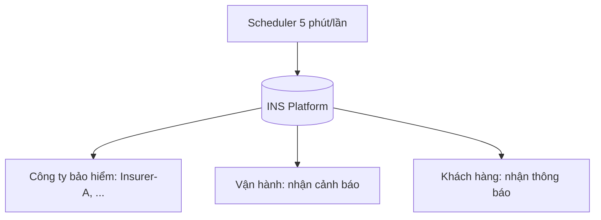
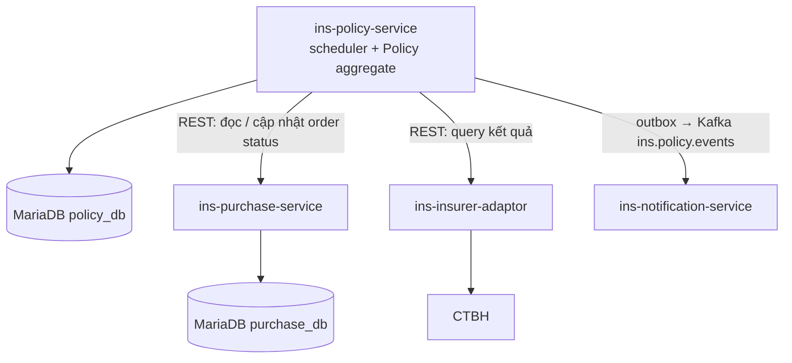
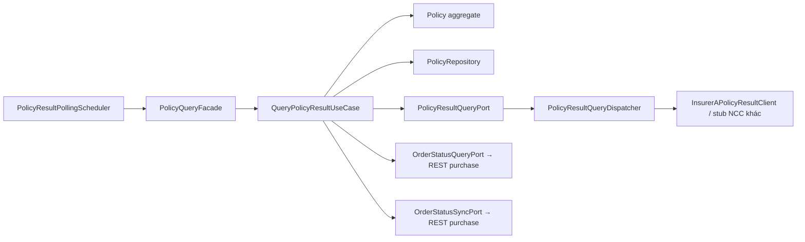
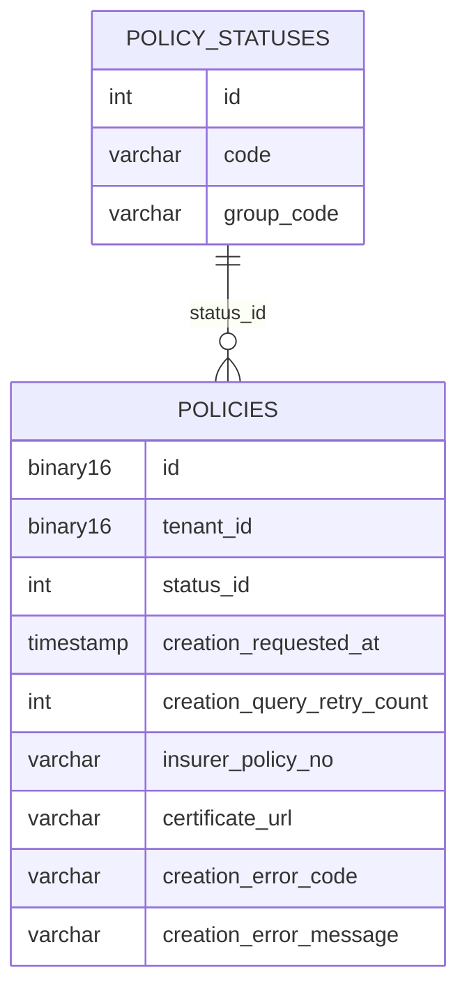

> Ví dụ điền thật từ dự án INS Platform (đã ẩn danh). Template gốc: templates/bo-sung/plan.md

# Kế hoạch triển khai: Luồng truy vấn kết quả tạo hợp đồng

**Nhánh**: TODO: dự án chưa ghi tên nhánh — cần Tech Lead bổ sung | **Ngày**: 2026-06-17 (cập nhật 2026-06-19) | **Spec**: `Approved_SRS_Luồng truy vấn kết quả tạo hợp đồng.docx` v1.0 (27/05/2026)

**Đầu vào**: SRS đã duyệt ở trên + hiện trạng code sau đợt "Plan đồng bộ status Order/Policy" (đã live)

**Trạng thái**: DRAFT — nghiệp vụ §1/§2 đã đối chiếu khớp SRS 1-1; blocker trạng thái phần lớn đã giải toả; D1–D4 đã chốt; D5–D7 còn mở; chưa code.

> Cảnh báo Gate 2: Tech Lead phải đọc, sửa và chịu trách nhiệm cho từng quyết định kiến trúc, không merge nguyên văn đề xuất của AI.

---

## 1. Tóm tắt (Summary)

Xây một **scheduler tự động truy vấn kết quả tạo hợp đồng** từ công ty bảo hiểm (CTBH) cho các đơn đã gửi yêu cầu cấp HĐ nhưng **chưa nhận được kết quả cuối** (callback bị miss/lag). Khi có kết quả, hệ thống cập nhật trạng thái **Policy** + **Order**, lưu mã HĐ và link GCN, rồi đẩy event để `ins-notification-service` gửi thông báo cho KH.

**Đặc tả vận hành (SRS):** chạy **5 phút/lần**, **tối đa 3 lượt retry** (cấu hình được). Precondition: HĐ chưa active. Post-condition: nhận và cập nhật kết quả tạo HĐ.

**Luồng 7 bước:**

| Bước | Đối tượng | Hành động |
|---|---|---|
| 1 | Nền tảng | Quét bản ghi thoả: order = `POLICY_REQUEST_TIMEOUT`, **hoặc** order = `POLICY_REQUEST_SUCCESS` và `now − thời_gian_request_thành_công ≥ x phút`; **và** retry < cấu hình; **và** sản phẩm thuộc danh sách quét |
| 2 | Nền tảng | Gọi CTBH truy vấn kết quả (mã giao dịch, mã sản phẩm, mã đối tác…). Fail/timeout còn retry → giữ nguyên, +1 retry. Fail/timeout hết retry → giữ nguyên + **cảnh báo vận hành** |
| 3 | CTBH | Trả **Từ chối** (mã lỗi + nội dung) → bước 4; hoặc **Thành công** (trạng thái HĐ, mã HĐ, link GCN…) → bước 5 |
| 3.1 | Nền tảng | **Kiểm tra chéo** với trạng thái hiện tại (ma trận bên dưới) — chống ghi đè sai, phát hiện drift |
| 4 | Nền tảng | FAILED: policy → `POLICY_FAILED`, order → `POLICY_ISSUE_FAILED`, lưu lỗi. REJECTED: policy → `POLICY_REJECTED`, order → `POLICY_ISSUE_FAILED`, lưu lỗi, kiểm cấu hình hoàn tiền (chỉ khung) → bước 6 |
| 5 | Nền tảng | SUCCESS: policy → `POLICY_ACTIVE`, order → `POLICY_ISSUE_SUCCESS`, lưu mã HĐ + link GCN → bước 6 |
| 6 | Nền tảng | Đẩy event lên Kafka kèm **mã campaign** |
| 7 | notification-service | Gửi thông báo tới KH |

**Ma trận quyết định bước 3.1 (bắt buộc implement đúng — so theo leaf status + `group_code`, không dùng sub_status):**

| CTBH trả | Điều kiện hiện tại | Hành động |
|---|---|---|
| FAILED / REJECTED | policy = `POLICY_ACTIVE` | Giữ nguyên + cảnh báo vận hành (conflict) |
| FAILED / REJECTED | policy ∈ {`POLICY_INIT`, `POLICY_NEED_UPDATE`, `POLICY_PENDING_APPROVAL`} **và** order ∈ {`POLICY_REQUEST_SUCCESS`, `POLICY_REQUEST_TIMEOUT`} | Bước 4 |
| SUCCESS | policy ∈ {`POLICY_FAILED`, `POLICY_REJECTED`} | Giữ nguyên + cảnh báo vận hành |
| SUCCESS | policy ∈ {`POLICY_INIT`, `POLICY_NEED_UPDATE`, `POLICY_PENDING_APPROVAL`} **và** order ∈ {`POLICY_REQUEST_SUCCESS`, `POLICY_REQUEST_TIMEOUT`} | Bước 5 |
| Mọi trường hợp khác | — | No-op idempotent |

**Ngoài phạm vi (Phase 2 theo SRS):** hoàn tiền tự động (`CASHBACK_INIT`) và hoàn tiền thủ công trên CMS. Phase 1 chỉ dựng khung trạng thái.

**Hướng tiếp cận kỹ thuật:** tổng quát hoá và chính thức hoá `PendingPolicyActivationScheduler` đang có trong policy-service (hiện chỉ poll Insurer-A BHXM, không có retry, không xử lý TIMEOUT, không có nhánh FAILED/REJECTED, không đồng bộ order, không cảnh báo). Mirror 1-1 kiến trúc luồng "truy vấn kết quả thanh toán" đã chạy ổn trong payment-service.

---

## 2. Bối cảnh kỹ thuật (Technical Context)

| Hạng mục | Giá trị |
|---|---|
| Ngôn ngữ / Phiên bản | Java 21 |
| Thư viện / Phụ thuộc chính | Spring Boot 3.5, `@Scheduled` + `@ConditionalOnProperty`, Kafka (qua Transactional Outbox), `platform-libs` (domain-core, event-core, spring-web) |
| Lưu trữ | MariaDB `policy_db` (policy-service), `purchase_db` (purchase-service) |
| Kiểm thử | JUnit (domain, application), ArchUnit, Testcontainers (integration) |
| Nền tảng mục tiêu | Kubernetes on-prem |
| Loại dự án | web-service (microservice nội bộ + scheduler) |
| Mục tiêu hiệu năng | **CẦN LÀM RÕ** — SRS chỉ nêu chu kỳ 5 phút/lần, 3 retry; chưa có batch-size mặc định, thời gian tối đa mỗi vòng quét |
| Ràng buộc | Gọi HTTP sang CTBH **ngoài** transaction lưu; mỗi policy một transaction riêng (lỗi 1 bản ghi không rollback cả batch); 1 transaction = 1 aggregate |
| Quy mô / Phạm vi | 4 service đụng tới (policy, purchase, insurer-adaptor, notification); product-service defer. Khối lượng bản ghi cần quét: **CẦN LÀM RÕ** |

---

## 3. Kiểm tra Hiến chương (Constitution Check)

| Điều khoản (Architecture.md / CLAUDE.md / LESSONS.md) | Đạt? | Ghi chú / Miễn trừ |
|---|---|---|
| Dependency rule `adapter → application → domain`, ArchUnit pass | [x] | Thiết kế đặt scheduler/facade/dispatcher ở adapter, UseCase + port ở application, method trạng thái ở domain `Policy` |
| Scheduler phải đi qua Facade, không gọi UseCase trực tiếp | [x] | `PolicyResultPollingScheduler` → `PolicyQueryFacade.queryOne(id)` |
| UseCase không là Spring bean | [x] | `QueryPolicyResultUseCase` là POJO, wire `@Bean` trong `UseCaseConfig` với `maxRetry` inject |
| 1 transaction = 1 aggregate; không dual-write Kafka | [x] | Policy và Order là 2 aggregate ở 2 service → đồng bộ order qua REST/event idempotent; event notification qua outbox |
| Domain event phát từ aggregate | [x] | `PolicyCreationSucceeded/Failed/Rejected/QueryTimedOut/ConflictDetected` phát từ `Policy` |
| Không tạo khái niệm `sub_status` | [x] | Dùng leaf status + `group_code` (đã flatten) |
| Guard trước side-effect (LESSONS §1) | [x] | UseCase: guard idempotent + đọc order status + policy status **trước** khi gọi CTBH và ghi DB |
| Migration qua Flyway, `ddl-auto` validate ngoài local | [ ] | **Miễn trừ chưa duyệt:** DB hiện execute SQL trực tiếp (không Flyway) + cập nhật `TSD/sql_scripts/ins-policy-service.sql`. Cần kiểm `ddl-auto` của policy-service trước khi thêm cột |
| Cấu hình quét theo từng sản phẩm (SRS bước 1) | [ ] | **Lệch SRS có chủ đích (D4=c):** Phase 1 dùng tham số toàn cục; cấu hình per-product defer |

---

## 4. C4 Model — Kiến trúc

### 4.1 Level 1 — System Context



| Thành phần | Loại | Mô tả | Giao thức |
|---|---|---|---|
| Scheduler | Trigger nội bộ | Kích hoạt quét theo cron | — |
| INS Platform | System | Hệ thống đang xây | — |
| Công ty bảo hiểm | External System | Trả kết quả tạo HĐ khi được truy vấn | REST/SOAP qua insurer-adaptor, payload mã hoá AES-256-GCM |
| Vận hành | Actor | Nhận cảnh báo khi hết retry hoặc conflict | Audit `Severity.CRITICAL` + topic audit |
| Khách hàng | Actor | Nhận thông báo kết quả | SMS/Email/Zalo qua notification-service |

### 4.2 Level 2 — Container



| Container | Công nghệ | Trách nhiệm | Ghi chú |
|---|---|---|---|
| ins-policy-service | Spring Boot 3.5 | **Sở hữu** scheduler, bộ đếm retry, áp ma trận §1 | D1 = policy-service |
| ins-purchase-service | Spring Boot 3.5 | Cung cấp order status; nhận cập nhật `POLICY_ISSUE_*` (guard chỉ từ `POLICY_REQUEST_SUCCESS/TIMEOUT`) | Khung hoàn tiền Phase 2 |
| ins-insurer-adaptor | Spring Boot 3.5 | Endpoint truy vấn kết quả theo NCC, chuẩn hoá SUCCESS/FAILED/REJECTED/PENDING | Tổng quát hoá `query-order` của Insurer-A |
| ins-notification-service | Spring Boot 3.5 | Consume event, map campaign, gửi thông báo | Phần lớn đã có |
| ins-product-service | — | ⏸️ Defer (D4=c) | Nâng khi cần per-product |

### 4.3 Level 3 — Component (ins-policy-service)



| Component | Thuộc container | Trách nhiệm | File dự kiến |
|---|---|---|---|
| `PolicyResultPollingScheduler` | policy-service | `@Scheduled cron` + `@ConditionalOnProperty`; tìm bản ghi cần quét, lặp gọi facade; log metric (scanned/succeeded/failed/timeout/skipped/elapsed) | `adapter/inbound/scheduler/` |
| `PolicyQueryFacade` | policy-service | `@Transactional queryOne(UUID)` — biên giao dịch mỗi policy | `adapter/inbound/facade/` |
| `QueryPolicyResultUseCase` (impl `QueryPolicyResultInbound`) | policy-service | Guard idempotent, đếm retry, gọi CTBH, áp ma trận, mark timeout, publish event + audit. Trả `Outcome {SUCCEEDED, FAILED, REJECTED, PENDING, TIMED_OUT, SKIPPED, CONFLICT}` | `application/usecase/` |
| `Policy` (mở rộng) | policy-service | Field `creationRequestedAt`, `creationQueryRetryCount`; method `recordCreationResult(...)`, `markCreationQueryExhausted(now)`, `incrementCreationQueryRetry()` | `domain/aggregate/` |
| `PolicyResultQueryDispatcher` | policy-service | Route theo `nccCode` tới client per NCC; stub cho NCC chưa hỗ trợ | `adapter/outbound/` |
| `OrderStatusQueryAdapter` / `OrderStatusSyncAdapter` | policy-service | REST sang purchase-service (hoặc event nếu đồng bộ bất đồng bộ) | `adapter/outbound/` |

### 4.4 Level 4 — Code

Không vẽ. Mẫu đối chiếu 1-1 với payment-service:

| Payment (đã chạy) | Policy (mới) |
|---|---|
| `GatewayResultPollingScheduler` | `PolicyResultPollingScheduler` |
| `GatewayQueryFacade` | `PolicyQueryFacade` |
| `QueryGatewayResultUseCase` / `QueryGatewayResultInbound` | `QueryPolicyResultUseCase` / `QueryPolicyResultInbound` |
| `PaymentTransaction.gatewayRequestedAt` / `markQueryTimeout()` | `Policy.creationRequestedAt` / `markCreationQueryExhausted()` |
| `findStuckForQuery(before, limit)` | `findStuckForCreationQuery(requestedBefore, productIds, maxRetry, limit)` |
| `GatewayClientPort` + `GatewayClientDispatcher` + `WalletXClient` | `PolicyResultQueryPort` + `PolicyResultQueryDispatcher` + client per NCC |
| `ins.scheduler.payment-query.*` | `ins.scheduler.policy-query.*` |

> Khác biệt quan trọng: payment hết retry → đổi sang `PAYMENT_TIMEOUT`; **policy hết retry → GIỮ NGUYÊN status** (SRS bước 2), chỉ bật cờ + phát event cảnh báo.

---

## 5. Quyết định kiến trúc (ADR)

| Mã | Tiêu đề | Trạng thái | Ngày | Liên quan |
|---|---|---|---|---|
| D1 | Service sở hữu scheduler + bộ đếm retry = **policy-service** (tận dụng `PendingPolicyActivationScheduler` + adapter query CTBH có sẵn). Loại: purchase-service. Hệ quả: mỗi vòng quét phải đọc order status xuyên service qua `OrderStatusQueryPort` | Accepted | 2026-06-19 | B6 |
| D2 | Retry + mốc thời gian = **cột trên `policies`** (`creation_query_retry_count`, `creation_requested_at`). Loại: bảng attempts riêng; cột trên `orders` | Accepted (kèm cảnh báo) | 2026-06-19 | B6 — điều kiện quét SRS là ORDER-centric, cân nhắc lại cặp D1/D2 cùng nhau |
| D3 | API truy vấn CTBH = **dispatcher per NCC** (giống `GatewayClientDispatcher` của payment). Loại: chuẩn hoá một endpoint chung cho mọi NCC | Accepted | 2026-06-19 | B6 |
| D4 | Cấu hình quét = **tham số toàn cục** trong `application.yml` (`enabled`, `cron`, `batch-size`, `min-age-minutes`, `max-retry`). Loại: mở rộng `InsurerIntegration.config`; bảng master mới | Accepted (lệch SRS) | 2026-06-19 | B6 — SRS đòi per-product; defer |
| D5 | Kênh cảnh báo vận hành = audit `Severity.CRITICAL` + event Kafka audit stream. Slack/email defer | Proposed | — | B6 |
| D6 | Mã campaign: producer gửi `campaign_code` trong payload, hay notification-service map `event_type` → campaign | Proposed — chốt với team notification | — | B6 |
| D7 | CTBH trả "đang xử lý/PENDING" có tính vào retry không. Đề xuất: **không** — chỉ lỗi giao tiếp mới +retry | Proposed — cần BA xác nhận | — | B6 |

> TODO: các quyết định trên đang nằm trong file plan, chưa tách thành file ADR riêng theo quy ước `ADR-<SERVICE>-NN-<slug>` — cần Tech Lead bổ sung.

---

## 6. Mô hình dữ liệu (ERD)



| Thực thể | Thuộc tính chính | Khoá | Ghi chú |
|---|---|---|---|
| `policies` | **Thêm:** `creation_requested_at` (timestamptz), `creation_query_retry_count` (int default 0), `insurer_policy_no`, `certificate_url`, `creation_error_code`, `creation_error_message` (nếu chưa có) | PK `id`, FK `status_id` | ❌ Còn phải làm. **Không** thêm `sub_status_id` |
| `policy_statuses` | 11 leaf + `group_code` (id 10–20) | PK `id` | ✅ Đã xong |
| `order_statuses` / `orders` | `POLICY_REQUEST_SUCCESS` (21) / `POLICY_REQUEST_TIMEOUT` + backfill | — | ✅ Đã xong (purchase-service) |
| `insurer_integrations` | Không đổi | — | ⏸️ Defer (D4=c) |
| Index | `idx_policies_creation_query (tenant_id, status_id, creation_requested_at)` | — | ❌ Còn phải làm |

**Chiến lược migration**: DB hiện chạy SQL trực tiếp (không Flyway) và cập nhật file `TSD/sql_scripts/ins-policy-service.sql`. Theo LESSONS §11: chạy schema **trước**, deploy code **sau** (k8s `ddl-auto=none` không chết lúc boot mà trả 500 ở request).

---

## 7. Đặc tả API (OpenAPI 3.x)

File: TODO: dự án chưa có file contract riêng cho feature — cần Tech Lead bổ sung.

| Method | Path | Mục đích | Auth | AC liên quan |
|---|---|---|---|---|
| TODO | TODO (endpoint nội bộ purchase-service) | Đọc order status cho `OrderStatusQueryPort` | M2M nội bộ | SRS bước 1 |
| TODO | TODO (endpoint nội bộ purchase-service) | Cập nhật kết quả phát hành `markPolicyIssueResult(orderId, success/failed)` — chỉ cho phép từ `POLICY_REQUEST_SUCCESS/TIMEOUT` | M2M nội bộ | SRS bước 4, 5 |
| TODO | TODO (endpoint insurer-adaptor per NCC) | Truy vấn kết quả tạo HĐ: nhận mã giao dịch / mã sản phẩm / mã đối tác, trả SUCCESS/FAILED/REJECTED/PENDING + mã HĐ + GCN + mã lỗi | M2M nội bộ | SRS bước 2, 3 |

**Quy ước chung của dự án**: response wrap `ApiResponse.of(...)`; lỗi RFC 7807; `partnerRequestId` deterministic (đã có ở `WorkflowExecution`). Event notification theo envelope snake_case (thêm `campaign_code` nếu chốt D6=a).

---

## 8. Cấu trúc mã nguồn (Source Code Structure)

```text
ins-policy-service/
├── domain/        Policy (+ field/method mới), PolicyEvents (5 event mới),
│                  PolicyRepository.findStuckForCreationQuery(...)
├── application/   QueryPolicyResultInbound + Outcome, QueryPolicyResultUseCase,
│                  PolicyResultQueryPort, OrderStatusQueryPort, OrderStatusSyncPort
└── adapter/
    ├── inbound/scheduler/  PolicyResultPollingScheduler
    ├── inbound/facade/     PolicyQueryFacade
    ├── outbound/           PolicyResultQueryDispatcher, InsurerAPolicyResultClient,
    │                       OrderStatusQueryAdapter, OrderStatusSyncAdapter
    └── configuration/      UseCaseConfig (@Bean), application.yml ins.scheduler.policy-query.*

ins-purchase-service/   endpoint nội bộ đọc/cập nhật order status + khung refund
ins-insurer-adaptor/    endpoint truy vấn kết quả per NCC + chuẩn hoá response
ins-notification-service/  xác nhận contract event + campaign mapping
```

---

## 9. Chiến lược kiểm thử & triển khai

| Nội dung | Quyết định |
|---|---|
| ArchUnit | Build pass cho mọi service đụng tới |
| Đơn vị (domain) | Đủ tổ hợp ma trận §1: (CTBH SUCCESS/FAILED/REJECTED) × (policy/order status) → đúng nhánh (chuyển trạng thái / no-op / conflict). Retry < max → +1 giữ nguyên; = max → cảnh báo |
| UseCase | Idempotent (quét lại policy đã terminal = `SKIPPED`); guard order status |
| Tích hợp (Integration) | Scheduler quét đúng bản ghi (status + thời gian + retry); lỗi 1 policy không rollback cả batch |
| Mapper / Migration | status ↔ id hai chiều; chạy trên dump mẫu, không FK mồ côi |
| Contract | Response insurer-adaptor; event notification (envelope + `campaign_code`); đồng bộ order status |
| E2E | Tạo HĐ pending → scheduler quét → CTBH trả SUCCESS/FAILED/REJECTED → policy + order cập nhật đúng → thông báo phát đi |
| Hiệu năng | TODO: dự án chưa có — cần Tech Lead bổ sung |
| CI/CD | TODO: plan không nêu — xem quy chuẩn chung (GitLab CI) |

**Kế hoạch theo phase:**

| Phase | Nội dung |
|---|---|
| 0 | Chốt D5–D7 + thêm cột `creation_*` (chặn các phase sau) |
| 1 | insurer-adaptor: endpoint truy vấn per NCC, test với Insurer-A trước |
| 2 | ~~Product config~~ — bỏ qua (D4=c) |
| 3 | policy-service domain + application: field/method, event, repository query, port, UseCase, wiring; unit test state machine |
| 4 | policy-service adapter: scheduler, facade, dispatcher/client, order adapter, `application.yml`; quyết định gộp/thay `PendingPolicyActivationScheduler` |
| 5 | purchase-service: endpoint đọc/cập nhật order status + khung refund |
| 6 | notification: contract event + campaign mapping; cảnh báo qua audit CRITICAL |
| 7 | Test & rollout |

---

## 10. Rủi ro kỹ thuật

| # | Rủi ro | Xác suất | Tác động | Giảm thiểu |
|---|---|---|---|---|
| R1 | Ghi đè sai trạng thái do race với callback đối tác / hậu kiểm | TODO | Cao | Tuân ma trận §1; transition idempotent; guard theo cả order + policy; conflict → cảnh báo, không ghi đè |
| R2 | Quét trùng/sớm (cron 5 phút + retry 3, `min-age` theo sản phẩm) | TODO | TB | Lọc `creation_requested_at <= now − minAgeMinutes`; bộ đếm retry trên aggregate |
| R3 | CTBH trả "đang xử lý" lẫn với fail | TODO | TB | Chốt D7: PENDING không tính retry |
| R4 | Đồng bộ order ↔ policy xuyên 2 service, 2 aggregate | TODO | Cao | 1 transaction = 1 aggregate; REST/event idempotent; outbox, không dual-write |
| R5 | Hai scheduler cùng activate (trùng `PendingPolicyActivationScheduler`) | TODO | Cao | Quyết định gộp/thay ở Phase 4 |
| R6 | Hoàn tiền (Phase 2) bị kéo vào Phase 1 | TODO | TB | Chỉ set khung trạng thái, không nối logic |

> Plan gốc không chấm xác suất — TODO: cần Tech Lead bổ sung.

**Điểm không nhất quán cần xử lý trước Gate 2 (phát hiện khi điền mẫu):**
- Phase 4 và mục kiểm thử tích hợp vẫn nhắc "product-config adapter" / "product filter" dù D4=c đã bỏ.
- §6.1 ghi hết retry thì **giữ nguyên** status, còn mục kiểm thử ghi "= max → timeout + cảnh báo".
- Tài liệu tham chiếu tổng (SRS V2 sync) ghi owner là `ins-callback-service` với `QueryPolicyResultScheduler`; plan đã chốt D1 = policy-service. Cần cập nhật tài liệu tham chiếu.

**Spike cần làm trước**: [ ] TODO: plan không nêu spike — cần Tech Lead bổ sung.

**Câu hỏi mở cho BA / Tech Lead:** (D6) cơ chế mã campaign · (D7) PENDING có tính retry không · giá trị mặc định của "x phút" và có khác theo sản phẩm không · kênh cảnh báo Slack/email có cần ở Phase 1 không.

---

## 11. Checklist ký duyệt — Gate 2

- [ ] plan.md hoàn chỉnh, Tech Lead đã sửa — **chưa**: còn D5–D7 và 3 điểm không nhất quán ở §10
- [ ] ADR đã tách file và qua `adr-rules.md` — **chưa** (D1–D7 đang nằm trong plan)
- [ ] OpenAPI đã qua `api-rules.md` — **chưa có** contract (§7 TODO)
- [x] C4 Level 1–3 đã có, ERD khớp data model của spec
- [ ] Constitution Check đạt — **còn 2 miễn trừ chưa duyệt** (migration không qua Flyway; lệch SRS per-product)
- [ ] Design Review với Dev senior — TODO: chưa có ghi nhận
- [ ] Đã commit plan.md/ADR/C4/OpenAPI vào repo — plan đã có trong `documents/`; ADR/OpenAPI chưa
- [ ] Tech Lead ký Gate 2 — chưa

---

## Nguồn tham chiếu

- `documents/Plan_Truy_van_ket_qua_tao_hop_dong.md` (lập 2026-06-17, cập nhật 2026-06-19) — tài liệu nội bộ
- `Approved_SRS_Luồng truy vấn kết quả tạo hợp đồng.docx` v1.0
- `documents/Plan_Dong_bo_Status_Order_Policy.md` (mô hình leaf status + `group_code`)
- `Architecture.md`, `CLAUDE.md`, `LESSONS.md §1, §7, §11`
